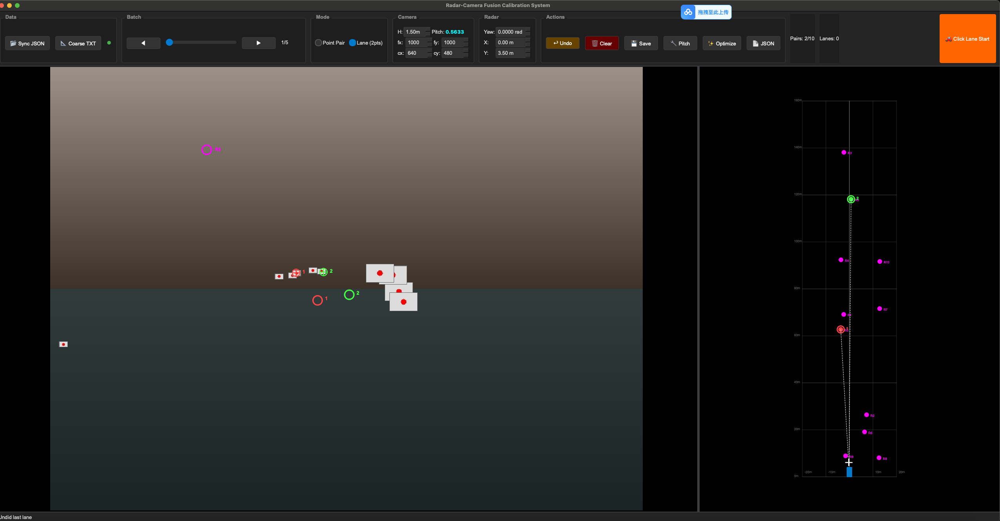
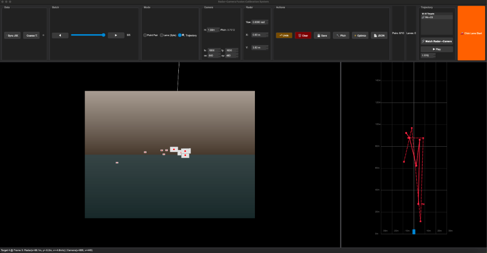
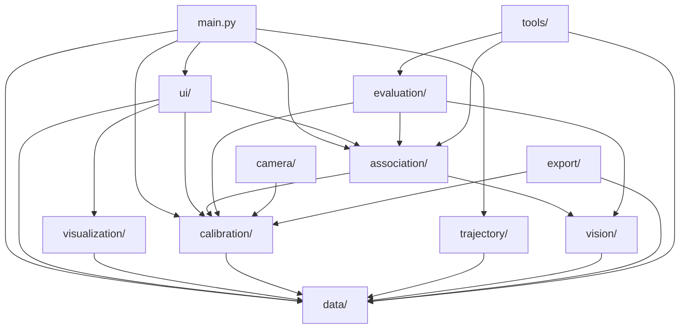

# Radar-Camera Fusion Calibration System
# 雷达-相机融合标定可视化系统

> Author: **caiusy**

A modular Python/PyQt6/OpenCV toolkit for radar-camera calibration, BEV visualization,
trajectory analysis, vision detection fusion, radar-vision association, evaluation metrics,
and effective detection area analysis.

### 预览 / Preview

| 点对标定 + BEV | 轨迹回放 |
|:---:|:---:|
|  |  |

---

## 功能概览 / Features

| 功能 | 描述 |
|------|------|
| **数据加载** | 同步 JSON + 雷达 JSON + 图像 + 视觉检测 JSON 自动关联 |
| **点对标定** | 交互式选择雷达→图像对应点，RANSAC Homography 计算 |
| **车道线标定** | 绘制平行车道线自动估计消失点和 Pitch 角 |
| **轨迹可视化** | 雷达/相机多目标轨迹 BEV 显示、配对和回放 |
| **感知范围估计** | DBSCAN 去噪 + 栅格密度 + 轮廓提取 |
| **相机参数管理** | 相机内参 (K, 畸变系数)、外参、增强版 calibration.json |
| **视觉检测加载** | Vision JSON 加载、bbox 解析、bbox 底部中心反投影 BEV |
| **雷达-视觉匹配** | 图像门控 + BEV 门控 + 类别兼容 + Hungarian 最优匹配 |
| **关联评估指标** | radar_recall, radar_fp_rate, BEV 误差, 距离分箱, 车道分段, 栅格统计 |
| **有效感知区域** | 栅格 recall 分析 → 有效区域/盲区多边形 + JSON 导出 |
| **模拟数据** | 一键生成带 vision detection + association GT 的仿真数据集 |
| **JSON 导出** | 标定结果、评估指标和感知范围 JSON 标准输出 |

---

## 快速开始 / Quick Start

### 安装依赖

```bash
pip install -r requirements.txt
```

### 运行主程序

```bash
python main.py
```

### 生成模拟数据 (含视觉检测和关联 GT)

```bash
python tools/generate_mock_dataset.py --output mock_dataset --num_frames 200
```

### 自动化关联测试

```bash
python tools/auto_test_association.py --dataset mock_dataset
```

### 自动化评估测试

```bash
python tools/auto_test_evaluation.py --dataset mock_dataset
```

### 运行测试

```bash
python -m unittest discover -s tests -v
```

### ES-MEOT 互操作与时间拟合

`data/es_meot_adapter.py` 只读取用户已经放置在本地的可信 ES-MEOT
`radarTrack.npy` 和 `config`。ES-MEOT 雷达坐标约定为 `x=lateral`,
`y=vertical`, `z=forward`，所以标定平面使用 `(x, z)`，不能把原始 `(x, y)`
误当成地面坐标。

```bash
python tools/fit_esmeot_time.py /path/to/es_meot --camera-fps 20 \
  --output outputs/esmeot_time_sync.json
```

该命令只拟合帧时钟映射，不会伪造硬件触发延迟，也不会把数据写入仓库。
`generate_mock_dataset.py` 现在会稳定导出有效的 `mock_matched_points.json`；
导出的点对只来自模拟真值，不代表真实 ES-MEOT 标定结果。

---

## 项目结构 / Architecture

```
RadarCamCalib/
│
├── main.py                         # 程序入口 (PyQt6 MainWindow)
├── requirements.txt                # Python 依赖
├── README.md
│
├── data/                           # ① 数据层 — 数据加载与解析
│   ├── __init__.py                 #   统一导出接口
│   ├── data_models.py              #   核心数据结构 (dataclass)
│   ├── sync_loader.py              #   同步 JSON 解析器 (含 vision 支持)
│   ├── radar_loader.py             #   雷达 JSON 解析 + 中→英类别映射
│   ├── image_loader.py             #   图像加载 (OpenCV)
│   └── sync_dataset.py             #   数据集封装 (帧导航 + 按需加载 + vision)
│
├── camera/                         # ② 相机参数层 — 内参/外参管理
│   ├── __init__.py
│   ├── camera_model.py             #   CameraModel 数据结构 + 投影/去畸变
│   └── camera_io.py                #   相机参数 JSON 读写 + 增强标定格式
│
├── calibration/                    # ③ 标定算法层 — 无 UI 依赖
│   ├── __init__.py
│   ├── homography_solver.py        #   Homography + RANSAC (cv2.findHomography)
│   ├── calibration_session.py      #   标定会话管理 (add_point → compute → result)
│   ├── projector.py                #   坐标投影 (Radar ↔ Image 双向)
│   └── calibration_io.py           #   标定结果 JSON 读写
│
├── vision/                         # ④ 视觉检测层 — 目标检测数据
│   ├── __init__.py
│   ├── vision_models.py            #   VisionObject / VisionFrame 数据结构 + bbox 工具
│   └── vision_loader.py            #   Vision JSON 加载解析
│
├── association/                    # ⑤ 雷达-视觉关联层 — Hungarian 匹配
│   ├── __init__.py
│   ├── association_models.py       #   Match / AssociationResult 数据结构
│   ├── gating.py                   #   图像/BEV/类别 门控函数
│   ├── cost_function.py            #   加权 BEV+像素 代价矩阵
│   ├── hungarian_matcher.py        #   scipy.linear_sum_assignment 匈牙利匹配
│   └── associator.py               #   完整匹配 Pipeline 编排
│
├── evaluation/                     # ⑥ 评估指标层 — 关联质量分析
│   ├── __init__.py
│   ├── eval_models.py              #   EvaluationResult / 距离分箱 / 车道 / 栅格模型
│   ├── metrics.py                  #   recall/FP/BEV误差/百分位数/距离分箱/车道/栅格
│   └── effective_range.py          #   有效感知区域 + 盲区多边形分析
│
├── trajectory/                     # ⑦ 轨迹处理层 — SQLite + 分析
│   ├── __init__.py
│   ├── trajectory_models.py        #   TrajectoryPoint, Trajectory 数据结构
│   ├── trajectory_builder.py       #   从 Sync 数据构建轨迹
│   ├── trajectory_filter.py        #   轨迹筛选 (短轨迹过滤、类别过滤)
│   └── trajectory_db.py            #   SQLite 数据库 (带 dataset hash 缓存)
│
├── range_estimation/               # ⑧ 感知范围估计层
│   ├── __init__.py
│   ├── point_filter.py             #   基础过滤 + DBSCAN 去噪
│   ├── density_grid.py             #   栅格密度分析
│   ├── contour_extractor.py        #   轮廓 → 多边形 + 面积计算
│   └── range_estimator.py          #   完整 Pipeline (一键调用)
│
├── visualization/                  # ⑨ 可视化层 — 纯 OpenCV, 无 Qt 依赖
│   ├── __init__.py
│   ├── color_map.py                #   颜色定义 (点对颜色、类别颜色)
│   ├── image_overlay.py            #   图像叠加 (雷达投影/bbox/匹配线)
│   ├── bev_renderer.py             #   BEV 渲染 (帧/轨迹/vision BEV/有效区域)
│   └── radar_drawer.py             #   高级雷达绘制工具
│
├── ui/                             # ⑩ UI 层 — PyQt6 交互组件
│   ├── __init__.py
│   ├── image_view.py               #   图像视口 (点击交互、标注显示、叠加图像)
│   ├── bev_view.py                 #   BEV 视口 (轨迹/标定点/栅格/叠加BEV)
│   └── operations.py               #   操作状态机 (点对/车道线/轨迹/关联模式)
│
├── export/                         # ⑪ 导出层
│   ├── __init__.py
│   └── json_exporter.py            #   JSON + 文本报告导出
│
├── tools/                          # ⑫ 工具
│   ├── generate_mock_dataset.py    #   模拟数据集生成器 (含 vision + association GT)
│   ├── auto_test_association.py    #   自动化关联准确率测试
│   └── auto_test_evaluation.py     #   自动化评估指标计算
│
├── tests/                          # ⑬ 测试 (100 cases)
│   ├── test_data.py                #   数据层测试
│   ├── test_calibration.py         #   标定算法测试
│   ├── test_camera_model.py        #   相机参数测试
│   ├── test_vision_loader.py       #   视觉检测测试
│   ├── test_association.py         #   雷达-视觉关联测试
│   ├── test_evaluation.py          #   评估指标测试
│   ├── test_effective_range.py     #   有效感知区域测试
│   └── test_mock_dataset.py        #   模拟数据集测试
│
└── assets/                         # 预览截图
```

---

## 架构设计 / Architecture Design

### 分层依赖关系



### 核心原则

1. **分层解耦** — `data/` `calibration/` `trajectory/` `range_estimation/` `camera/` `vision/` `association/` `evaluation/` 无 UI 依赖，可独立 import 和测试
2. **四种 UI 模式** — 点对标定 / 车道线标定 / 轨迹回放 / 雷达-视觉关联 完全独立
3. **轨迹 DB 缓存** — 同一数据集不会重复加载，通过 dataset hash 判断
4. **中文兼容** — 雷达 JSON 中文类别 (`机动车` `行人` `非机动车`) 自动映射为英文

---

## 操作流程 / Workflow

### 1. 点对标定模式 (Point Pair Mode)

```
📂 Load Sync JSON → 选择数据集根目录
     ↓
🎯 Click Radar Point → 在图像上点击绿色雷达投影点
     ↓
📍 Click Image Point → 点击对应的实际图像位置
     ↓
重复 4~10 次 → 收集足够的点对
     ↓
📐 Compute H → 计算 Homography 矩阵 (RANSAC)
     ↓
💾 Save → 导出标定结果 JSON
```

### 2. 轨迹回放模式 (Trajectory Mode)

```
📂 Load Sync JSON → 加载数据集
     ↓
🔍 Switch to Trajectory Mode → 自动加载所有帧到 SQLite DB
     ↓
★ All Targets → 查看所有目标轨迹
     ↓
🔗 R{id}↔C{id} → 选择匹配的雷达-相机轨迹对
     ↓
▶ Play → 回放轨迹动画
```

### 3. 雷达-视觉关联模式 (Association Mode) 🆕

```
📐 Compute H → 先完成 Homography 标定
     ↓
🔗 Switch to Association Mode → 自动加载当前帧视觉检测
     ↓
图像叠加显示:
  - 绿色 bbox = 视觉检测框
  - 蓝色圆 = 雷达投影点
  - 黄色线 = 匹配连线 + 代价值
     ↓
BEV 叠加显示:
  - 圆形 = 雷达 BEV 点
  - 菱形 = 视觉反投影 BEV 点
     ↓
状态栏: 匹配数 | 未匹配雷达 | 未匹配视觉
     ↓
滑动帧导航 → 自动刷新关联结果
```

### 4. CLI 自动化测试

```bash
# 生成带 GT 的模拟数据集
python tools/generate_mock_dataset.py --output mock --num_frames 200

# 关联准确率测试 (对比 GT)
python tools/auto_test_association.py --dataset mock

# 评估指标 + 有效感知区域
python tools/auto_test_evaluation.py --dataset mock
```

---

## 数据格式 / Data Formats

### Sync JSON (`sync/*.sync.json`)

```json
{
  "sync_batch": 0,
  "batch_size": 3,
  "sensors": [...],
  "sensor_data": [
    {"channel_id": 0, "sensor_id": 1, "data_type": "image", "data_path": "image/xxx.jpg"},
    {"channel_id": 1, "sensor_id": 2, "data_type": "radar", "data_path": "radar/xxx.json"},
    {"channel_id": 2, "sensor_id": 3, "data_type": "vision_detection", "data_path": "vision/xxx.json"}
  ]
}
```

### Vision JSON (`vision/*.vision.json`) 🆕

```json
{
  "sensor_id": 3,
  "frame_index": 0,
  "time_stamp": 1700000000000,
  "image_path": "image/xxx.jpg",
  "objects": [
    {"id": 1, "track_id": 10, "class": "vehicle", "bbox": [100, 200, 300, 400], "score": 0.92}
  ]
}
```

### Association GT (`association_gt/*.association_gt.json`) 🆕

```json
{
  "frame_index": 0,
  "num_radar": 3,
  "num_vision": 4,
  "matches": [
    {"radar_idx": 0, "vision_idx": 1, "gt_id": 42}
  ]
}
```

### Enhanced Calibration JSON (v2.0) 🆕

```json
{
  "version": "2.0",
  "calibration_type": "radar_to_camera_homography",
  "homography": [[...], [...], [...]],
  "inverse_homography": [[...], [...], [...]],
  "camera_parameters": {
    "camera_matrix": [[fx,0,cx],[0,fy,cy],[0,0,1]],
    "distortion_coefficients": [k1,k2,p1,p2,k3],
    "image_size": {"width": 1920, "height": 1080}
  },
  "matched_points": [...],
  "mean_reprojection_error": 2.34
}
```

### Evaluation Results JSON 🆕

```json
{
  "radar_recall": 0.85,
  "radar_fp_rate": 0.15,
  "mean_bev_error": 3.2,
  "distance_bins": [
    {"range_str": "0-30m", "recall": 0.95, "mean_bev_error": 1.5}
  ],
  "effective_detection_area": {
    "observed_cells": 120,
    "effective_cells": 85,
    "blind_zone_cells": 10
  }
}
```

---

## 扩展指南 / Extension Guide

### 添加新的数据源

1. 在 `data/` 中创建新的 loader (如 `lidar_loader.py`)
2. 在 `data/data_models.py` 中定义对应的 dataclass
3. 在 `data/sync_dataset.py` 中添加加载逻辑
4. 在 `data/__init__.py` 中导出

### 添加新的标定算法

1. 在 `calibration/` 中创建新的 solver (如 `pnp_solver.py`)
2. 实现统一接口: 输入点对 → 输出 `CalibrationResult`
3. 在 `calibration/calibration_session.py` 中添加 solver 选择

### 添加新的可视化

1. 在 `visualization/` 中创建新的 renderer
2. 纯 OpenCV 实现，不依赖 Qt
3. 在 `ui/` 中创建对应的 Qt widget 调用 renderer

### 添加新的 UI 模式

1. 在 `ui/operations.py` 的 `AppMode` 枚举中添加新模式
2. 在 `OperationsController` 中添加状态转换逻辑
3. 在 `main.py` 中添加对应的信号处理和 UI 更新

### 替换轨迹存储后端

当前使用 SQLite (内存或文件)，如需替换：
1. 在 `trajectory/trajectory_db.py` 中实现新的后端类
2. 保持 `get_trajectory()`, `get_all_trajectories()` 等接口不变
3. `main.py` 中替换 `TrajectoryDB()` 的实例化

---

## 模块使用示例 / API Examples

### 加载数据集

```python
from data import SyncDataset

ds = SyncDataset()
ds.load("path/to/dataset")
print(f"Loaded {ds.num_frames} frames")

# 获取当前帧数据
img = ds.get_image()      # ImageFrame or None
radar = ds.get_radar()    # RadarFrame or None
vision = ds.get_vision()  # VisionFrame or None  🆕
```

### 计算标定

```python
from calibration.calibration_session import CalibrationSession

session = CalibrationSession()
session.add_point(radar_x=3.5, radar_y=42.0, image_u=640, image_v=400)
# ... 添加至少4个点对
result = session.compute()
print(f"Mean error: {result.mean_error:.2f} px")
print(f"Homography:\n{result.H}")
```

### 雷达-视觉关联 🆕

```python
from association.associator import associate_radar_vision

result = associate_radar_vision(radar_objects, vision_objects, H, H_inv)
print(f"Matches: {result.num_matches}")
print(f"Unmatched radar: {result.num_unmatched_radar}")

for m in result.matches:
    print(f"  R{m.radar_idx} ↔ V{m.vision_idx} (cost={m.cost:.3f})")
```

### 评估指标 🆕

```python
from evaluation.metrics import compute_association_metrics

metrics = compute_association_metrics(result, radar_objs, vision_objs, H_inv)
print(f"Recall: {metrics.radar_recall:.2%}")
print(f"FP Rate: {metrics.radar_fp_rate:.2%}")
print(f"Mean BEV Error: {metrics.mean_bev_error:.2f}m")
```

### 有效感知区域 🆕

```python
from evaluation.effective_range import compute_effective_detection_area

area = compute_effective_detection_area(all_matches, all_vision, all_radar, H_inv)
print(f"Effective cells: {area['stats']['effective_cells']}")
print(f"Blind zone cells: {area['stats']['blind_zone_cells']}")
```

### 投影雷达到图像

```python
from calibration.projector import project_radar_to_image, project_single_point
import numpy as np

# 批量投影
pts = np.array([[3.5, 42.0], [-2.0, 60.0]])
projected = project_radar_to_image(pts, result.H)

# 单点投影
u, v = project_single_point(3.5, 42.0, result.H)
```

### 轨迹数据库

```python
from trajectory import TrajectoryDB

db = TrajectoryDB()  # 或 TrajectoryDB("cache.db") 持久化

# 加载 (自动缓存，同数据集不重复加载)
count = db.load_all_radar_files("path/to/dataset")

# 查询
ids = db.get_all_target_ids()
traj = db.get_trajectory(target_id=42)  # [(frame_id, x, y), ...]
```

### 感知范围估计

```python
from range_estimation.range_estimator import estimate_radar_range
import numpy as np

points = np.array(...)  # Nx2 所有轨迹点
result = estimate_radar_range(points)
# result["range_polygons"] → 范围多边形列表
```

---

## 技术栈 / Tech Stack

- **Python 3.10+**
- **PyQt6** — UI framework
- **OpenCV** — image processing, homography, contour extraction
- **NumPy** — numerical computation
- **scikit-learn** — DBSCAN clustering
- **SciPy** — Hungarian matching (linear_sum_assignment)
- **SQLite** — trajectory database (built-in)

## License

MIT
