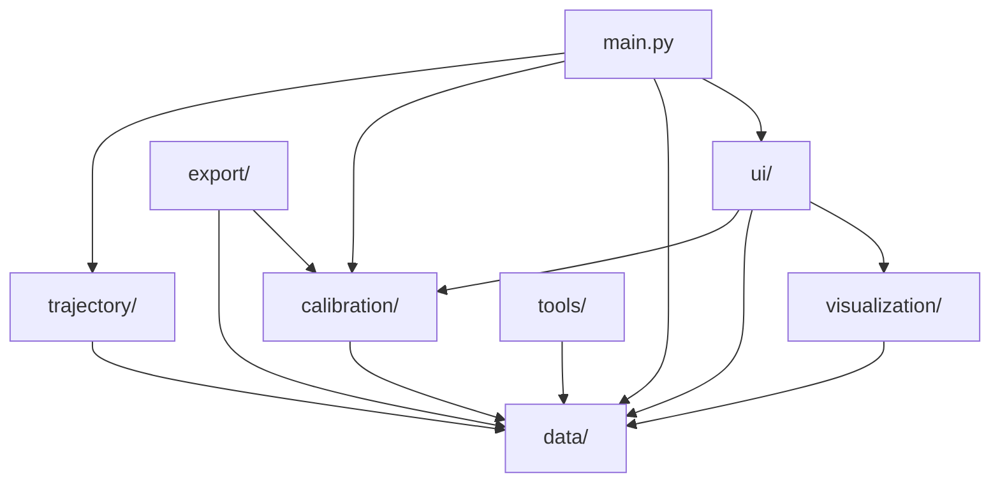

# Radar-Camera Fusion Calibration System
# 雷达-相机融合标定可视化系统

> Author: **caiusy**

A modular Python/PyQt6/OpenCV toolkit for radar-camera calibration, BEV visualization,
trajectory analysis, and radar range estimation.

---

## 功能概览 / Features

| 功能 | 描述 |
|------|------|
| **数据加载** | 同步 JSON + 雷达 JSON + 图像自动关联 |
| **点对标定** | 交互式选择雷达→图像对应点，RANSAC Homography 计算 |
| **车道线标定** | 绘制平行车道线自动估计消失点和 Pitch 角 |
| **轨迹可视化** | 雷达/相机多目标轨迹 BEV 显示、配对和回放 |
| **感知范围估计** | DBSCAN 去噪 + 栅格密度 + 轮廓提取 |
| **模拟数据** | 一键生成带车道线和车辆的仿真数据集 |
| **JSON 导出** | 标定结果和感知范围 JSON 标准输出 |

---

## 快速开始 / Quick Start

### 安装依赖

```bash
pip install -r requirements.txt
```

### 运行主程序

```bash
python main.py
```

### 生成模拟数据

```bash
python tools/generate_mock_dataset.py --output mock_dataset --num_frames 100
```

### 运行测试

```bash
python -m unittest discover -s tests -v
```

---

## 项目结构 / Architecture

```
RadarCamCalib/
│
├── main.py                         # 程序入口 (PyQt6 MainWindow)
├── requirements.txt                # Python 依赖
├── README.md
│
├── data/                           # ① 数据层 — 数据加载与解析
│   ├── __init__.py                 #   统一导出接口
│   ├── data_models.py              #   核心数据结构 (dataclass)
│   ├── sync_loader.py              #   同步 JSON 解析器
│   ├── radar_loader.py             #   雷达 JSON 解析 + 中→英类别映射
│   ├── image_loader.py             #   图像加载 (OpenCV)
│   └── sync_dataset.py             #   数据集封装 (帧导航 + 按需加载)
│
├── calibration/                    # ② 标定算法层 — 无 UI 依赖
│   ├── __init__.py
│   ├── homography_solver.py        #   Homography + RANSAC (cv2.findHomography)
│   ├── calibration_session.py      #   标定会话管理 (add_point → compute → result)
│   ├── projector.py                #   坐标投影 (Radar ↔ Image 双向)
│   └── calibration_io.py           #   标定结果 JSON 读写
│
├── trajectory/                     # ③ 轨迹处理层 — SQLite + 分析
│   ├── __init__.py
│   ├── trajectory_models.py        #   TrajectoryPoint, Trajectory 数据结构
│   ├── trajectory_builder.py       #   从 Sync 数据构建轨迹
│   ├── trajectory_filter.py        #   轨迹筛选 (短轨迹过滤、类别过滤)
│   └── trajectory_db.py            #   SQLite 数据库 (带 dataset hash 缓存)
│
├── range_estimation/               # ④ 感知范围估计层
│   ├── __init__.py
│   ├── point_filter.py             #   基础过滤 + DBSCAN 去噪
│   ├── density_grid.py             #   栅格密度分析
│   ├── contour_extractor.py        #   轮廓 → 多边形 + 面积计算
│   └── range_estimator.py          #   完整 Pipeline (一键调用)
│
├── visualization/                  # ⑤ 可视化层 — 纯 OpenCV, 无 Qt 依赖
│   ├── __init__.py
│   ├── color_map.py                #   颜色定义 (点对颜色、类别颜色)
│   ├── image_overlay.py            #   图像叠加绘制 (雷达投影、匹配点)
│   ├── bev_renderer.py             #   BEV 渲染 (帧/轨迹/范围多边形)
│   └── radar_drawer.py             #   高级雷达绘制工具
│
├── ui/                             # ⑥ UI 层 — PyQt6 交互组件
│   ├── __init__.py
│   ├── image_view.py               #   图像视口 (点击交互、标注显示)
│   ├── bev_view.py                 #   BEV 视口 (轨迹/标定点/栅格)
│   └── operations.py               #   操作状态机 (点对/车道线/轨迹模式)
│
├── export/                         # ⑦ 导出层
│   ├── __init__.py
│   └── json_exporter.py            #   JSON + 文本报告导出
│
├── tools/                          # ⑧ 工具
│   └── generate_mock_dataset.py    #   模拟数据集生成器
│
├── tests/                          # ⑨ 测试
│   ├── test_data.py                #   数据层测试 (30 cases)
│   └── test_calibration.py         #   标定算法测试
│
├── configs/
│   └── default_config.yaml         #   默认参数配置
│
└── dataset/                        # 数据集 (不提交 git)
```

---

## 架构设计 / Architecture Design

### 分层依赖关系



### 核心原则

1. **分层解耦** — `data/` `calibration/` `trajectory/` `range_estimation/` 无 UI 依赖，可独立 import 和测试
2. **两种模式分离** — 点对标定 (单帧操作) 与 轨迹回放 (全帧操作) 是完全独立的模式
3. **轨迹 DB 缓存** — 同一数据集不会重复加载，通过 dataset hash 判断
4. **中文兼容** — 雷达 JSON 中文类别 (`机动车` `行人` `非机动车`) 自动映射为英文

---

## 操作流程 / Workflow

### 1. 点对标定模式 (Point Pair Mode)

```
📂 Load Sync JSON → 选择数据集根目录
     ↓
🎯 Click Radar Point → 在图像上点击绿色雷达投影点
     ↓
📍 Click Image Point → 点击对应的实际图像位置
     ↓
重复 4~10 次 → 收集足够的点对
     ↓
📐 Compute H → 计算 Homography 矩阵 (RANSAC)
     ↓
💾 Save → 导出标定结果 JSON
```

### 2. 轨迹回放模式 (Trajectory Mode)

```
📂 Load Sync JSON → 加载数据集
     ↓
🔍 Switch to Trajectory Mode → 自动加载所有帧到 SQLite DB
     ↓
★ All Targets → 查看所有目标轨迹
     ↓
🔗 R{id}↔C{id} → 选择匹配的雷达-相机轨迹对
     ↓
▶ Play → 回放轨迹动画
```

---

## 数据格式 / Data Formats

### Sync JSON (`sync/*.sync.json`)

```json
{
  "sync_batch": 0,
  "batch_size": 2,
  "sensors": [
    {"frame_index": 266339, "sensor_id": 1, "time_stamp": 1767954310202},
    {"frame_index": 128723, "sensor_id": 2, "time_stamp": 1767954310202}
  ],
  "sensor_data": [
    {"channel_id": 0, "sensor_id": 1, "data_type": "image", "data_path": "image/xxx.jpg"},
    {"channel_id": 1, "sensor_id": 2, "data_type": "radar", "data_path": "radar/xxx.json"}
  ]
}
```

### Radar JSON (`radar/*.json`)

```json
{
  "baseId": 2,
  "objects": [
    {
      "id": 42,
      "class": "机动车",
      "coord": [3.5, 42.0],
      "props": {"speed": 15.0, "speedX": 0.1, "speedY": 14.9}
    }
  ]
}
```

### Calibration Result JSON

```json
{
  "version": "1.0",
  "calibration_type": "radar_to_camera_homography",
  "homography": [[...], [...], [...]],
  "inverse_homography": [[...], [...], [...]],
  "matched_points": [
    {"radar_point": {"x": 3.5, "y": 42.0}, "image_point": {"u": 640, "v": 400}}
  ],
  "mean_reprojection_error": 2.34,
  "max_reprojection_error": 5.67
}
```

---

## 扩展指南 / Extension Guide

### 添加新的数据源

1. 在 `data/` 中创建新的 loader (如 `lidar_loader.py`)
2. 在 `data/data_models.py` 中定义对应的 dataclass
3. 在 `data/sync_dataset.py` 中添加加载逻辑
4. 在 `data/__init__.py` 中导出

### 添加新的标定算法

1. 在 `calibration/` 中创建新的 solver (如 `pnp_solver.py`)
2. 实现统一接口: 输入点对 → 输出 `CalibrationResult`
3. 在 `calibration/calibration_session.py` 中添加 solver 选择

### 添加新的可视化

1. 在 `visualization/` 中创建新的 renderer
2. 纯 OpenCV 实现，不依赖 Qt
3. 在 `ui/` 中创建对应的 Qt widget 调用 renderer

### 添加新的 UI 模式

1. 在 `ui/operations.py` 的 `AppMode` 枚举中添加新模式
2. 在 `OperationsController` 中添加状态转换逻辑
3. 在 `main.py` 中添加对应的信号处理和 UI 更新

### 替换轨迹存储后端

当前使用 SQLite (内存或文件)，如需替换：
1. 在 `trajectory/trajectory_db.py` 中实现新的后端类
2. 保持 `get_trajectory()`, `get_all_trajectories()` 等接口不变
3. `main.py` 中替换 `TrajectoryDB()` 的实例化

---

## 模块使用示例 / API Examples

### 加载数据集

```python
from data import SyncDataset

ds = SyncDataset()
ds.load("path/to/dataset")
print(f"Loaded {ds.num_frames} frames")

# 获取当前帧数据
img = ds.get_image()      # ImageFrame or None
radar = ds.get_radar()    # RadarFrame or None
```

### 计算标定

```python
from calibration.calibration_session import CalibrationSession

session = CalibrationSession()
session.add_point(radar_x=3.5, radar_y=42.0, image_u=640, image_v=400)
# ... 添加至少4个点对
result = session.compute()
print(f"Mean error: {result.mean_error:.2f} px")
print(f"Homography:\n{result.H}")
```

### 投影雷达到图像

```python
from calibration.projector import project_radar_to_image, project_single_point
import numpy as np

# 批量投影
pts = np.array([[3.5, 42.0], [-2.0, 60.0]])
projected = project_radar_to_image(pts, result.H)

# 单点投影
u, v = project_single_point(3.5, 42.0, result.H)
```

### 轨迹数据库

```python
from trajectory import TrajectoryDB

db = TrajectoryDB()  # 或 TrajectoryDB("cache.db") 持久化

# 加载 (自动缓存，同数据集不重复加载)
count = db.load_all_radar_files("path/to/dataset")

# 查询
ids = db.get_all_target_ids()
traj = db.get_trajectory(target_id=42)  # [(frame_id, x, y), ...]
```

### 感知范围估计

```python
from range_estimation.range_estimator import estimate_radar_range
import numpy as np

points = np.array(...)  # Nx2 所有轨迹点
result = estimate_radar_range(points)
# result["range_polygons"] → 范围多边形列表
```

---

## 技术栈 / Tech Stack

- **Python 3.10+**
- **PyQt6** — UI framework
- **OpenCV** — image processing, homography
- **NumPy** — numerical computation
- **scikit-learn** — DBSCAN clustering
- **SQLite** — trajectory database (built-in)

## License

MIT
